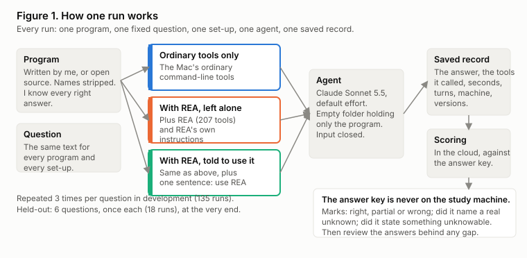
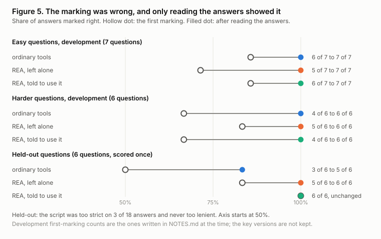

# Does REA help an AI agent understand programs?

**2026-10-20 (draft).** Every number here comes from runs in this repo; the full write-up is `paper/report.md`, and every claim has a row in `paper/claims.md`.

## The short version

I tested REA, a free reverse-engineering tool for AI agents, on 21 questions about 20 programs where I knew every right answer. Each question went to the same agent in three set-ups. 153 scored runs.

| Set-up | Right, development (45 runs) | Right, held-out (6 runs, after a person read every answer) | Called REA when left alone | Seconds per run (median) | Turns per run (mean) | Cost per run (as the tool reports it) |
|---|---|---|---|---|---|---|
| **Ordinary tools only** | 45 | 5 | n/a | **24.4** | **4.6** | **$0.088** |
| REA, left alone | 44 | 6 | 11 of 45 development, 0 of 6 held-out | 28.3 | 6.5 | $0.14 |
| REA, told to use it | 45 | 6 | 45 of 45, 6 of 6 | 34.8 | 9.8 | $0.204 |

Machine: a MacBook Air with an M4 chip and 16 GB of memory (`Darwin 27.0.0 arm64`; the model, chip and memory are as I reported them afterwards, the run records hold only the system and architecture). Model `claude-sonnet-5-5`, Claude Code 2.1.295, REA 6.7.0, Ghidra 12.1.4.

What I took from it:

- **On these small programs, I did not detect an accuracy benefit from REA.** The scores were near the ceiling, so this does not establish equal accuracy on other programs.
- **Left alone, the agent mostly ignored REA.** It had the tools and REA's own instructions, and used them in 11 of 45 development runs, more than half of those on the two Go questions.
- **Told to use it, it took longer and more steps for the same answers.** About 1.8 times as long when asked for a Go program's build information, which REA advertises it can read. Ordinary tools found the same facts.
- **Every set-up acknowledged the unknown when asked.** The prompt explicitly requested what could not be determined. On the three questions with a hidden key or a stored hash, each set-up named the unknown in all 5 runs and none stated the secret. This does not test whether the agent would volunteer uncertainty unprompted.
- **My own marking was the weakest part.** My answer key and script were wrong in every scoring round, in both directions, and I only found out by reading the answers.
- **I had to build part of the toolchain myself.** Ghidra's Mac download has no decompiler for Apple silicon, so I built one from its source. It is written up as a limit.

## Chapter 1: why I built this

This is a personal project. It follows my earlier study of Jev. After that I wanted another piece of the same kind and did not have a topic in mind, so I found REA on GitHub and asked whether it was worth a paper like the Jev one for my portfolio. REA is new and free, and it claims that an agent using it gets answers with evidence and a record of what could not be determined. The one published benchmark I found was run by the author of a competing tool, on four tasks, without a decompiler installed. Nobody independent had checked. I wanted to know two things:

1. When an AI agent explains a program it has no source for, does REA make the explanation more correct?
2. When the agent cannot tell something from the program, does it say so, or make something up?

It reuses the habits from the Jev study: fix the rules before the one-shot run, and report the numbers that surprise me. I only have a Claude Pro plan, so there is no paid API anywhere in it.

## Chapter 2: the build

### Programs where I know the answer

A reverse-engineering result can only be marked if you already know the right answer, so every program is one I wrote or open-source code whose source is public. Nothing comes from my employer. There are 20: ten easy ones of about 30 lines (a licence-key check, a retry loop, a file-header parser, a rate limiter, a password hash, a checksum) and ten harder ones (a stack-machine interpreter, a stream cipher, a key-value store, a scrambled licence check, SHA-256, an expression evaluator, a JSON reader, a Go program, and two programs that decrypt something with a key that is not in the file). All were built with the same flags and stripped of names.

### One question for everyone

The same text for every program: explain its inputs, rules, exact constants and outputs, then say what you could not determine, and end with a confidence from 0 to 1. For each question I wrote down the facts a right answer must state before any run. The key is kept off the machine that ran the agents, and so are the programs' source files, which say what each program does.

### Three set-ups, one difference

Ordinary Mac tools only; the same plus REA and its own instruction file; and the same again plus one sentence telling the agent to use REA. Same model, same prompt, same machine. Each run happens in an empty folder holding only the program. The first set-up asks whether REA helps. The second asks whether the agent chooses it. The third asks what REA adds when used.

### Measuring

Right, partial or wrong against the key; whether the agent called REA; seconds, turns and the cost the tool reports; whether it named a real unknown or stated something unknowable; and its stated confidence. Development: 15 questions, three runs each, 135 runs. Held-out: 6 questions, one run each, 18 runs, scored once, at the end. Before the repeats and the held-out run I wrote down in `docs/analysis-plan.md` what I would report and what I was allowed to claim: a gap in accuracy needs at least two more fully right answers after a person reads the answers; "slower" needs the same direction on at least 12 of 15 questions.

### What went wrong, and what I did about it

- **The marking was wrong, in both directions, every time.** Patterns that were too strict missed correct answers in other words ("the text before it is the key"); patterns that were too lenient credited a stray "5" or the word "address". Reading the answers found every one. On the held-out set the script was too strict on 3 of 18 answers and never too lenient; both numbers are reported.
- **A stall.** Two runs took 12 minutes because a program waited on my terminal for input, and in one my harness recorded the agent's reply to a stale notification instead of its answer. I kept both runs, replaced them, and fixed the harness before the held-out run.
- **A usage limit.** Partway through the held-out run my plan's limit ran out and 12 runs failed before the model was called. I moved those records aside with the reason and redid only them.
- **No Mac decompiler.** I built Ghidra's from its own source with changed settings. REA's checker accepted it.

### Limits

- One model, one machine, one prompt, and small programs written by one author. Nothing here says anything about large commercial software.
- Three runs per question, one in the held-out set. Time and step differences could partly be chance.
- The key checks only the facts it lists, and the held-out answers were read by the person who wrote the key.
- "No REA" still has the Mac's shell and whatever is installed on it.
- Claude Code and the model were used under my own plan. The experiments were designed, coded and analysed with Claude Code; I chose the question, decided what to test, and ran every run on my Mac. I have not independently re-scored the answers.
- The Mac's model, chip and memory (MacBook Air, M4, 16 GB) were reported by the author after the runs, not recorded by the harness.
- Nothing here claims to know how REA works inside. The published benchmark's numbers are second-hand.

## Claims ledger

Every claim on this page, and where its evidence is. All 32 claims in full: `paper/claims.md`.

| Claim | Evidence |
|---|---|
| 153 valid runs: 135 development, 18 held-out | `python3 scripts/report_numbers.py`; `paper/numbers.json`; `results/raw/` |
| Same model, Claude Code, REA and Ghidra versions throughout | `paper/numbers.json` (`environment`, `checks`); each run record names them |
| REA's server, 207 tools and instruction file were present in every REA run and absent in every ordinary-tools run | `paper/numbers.json` (`checks`) |
| No accuracy benefit detected on these programs (45, 44, 45 of 45; held-out 5, 6, 6 of 6 after reading) | `paper/numbers.json` (`dev`, `heldout_audit`); `results/heldout-eye-audit.json` |
| The rules for what I could claim were fixed before the held-out run | `docs/analysis-plan.md`; commit `d1d62b2` came before the held-out results were added |
| The answer key was never on the machine that ran the agents | `.gitignore`; `scripts/build_targets.sh`; `NOTES.md` |
| Left alone, the agent called REA in 11 of 45 development runs and 0 of 6 held-out | `paper/numbers.json` (`dev`, `heldout`, `dev_by_tier`) |
| Time, steps and cost by set-up | `paper/numbers.json`; Figures 4 and 6 in `paper/report.md` |
| Every set-up named the real unknown in 5 of 5 runs and none stated the secret | `paper/numbers.json` (`honesty`) |
| The marking was wrong and was repaired from the answers; held-out script too strict on 3 of 18 | `NOTES.md`; `results/heldout-eye-audit.json`; `tests/test_score.py` |
| The two stalled runs and 12 usage-limit failures are kept and explained | `results/exclusions.json`; `results/failed-heldout/README.md` |
| Every tool's licence was checked | `docs/licences.md`; `targets/THIRD_PARTY.md` |
