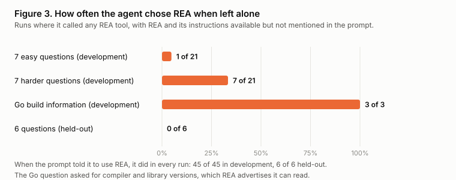
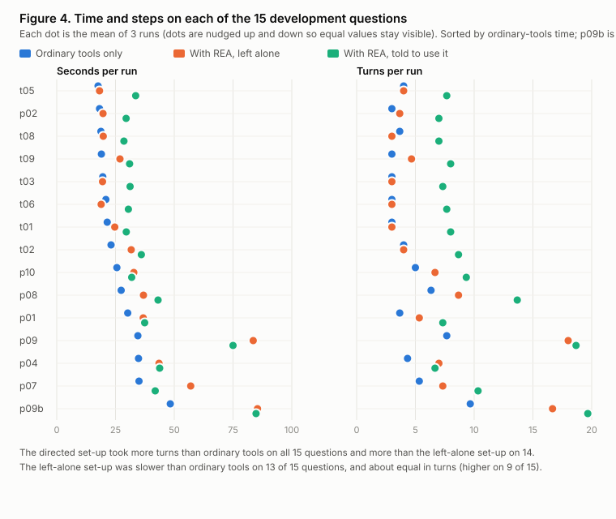
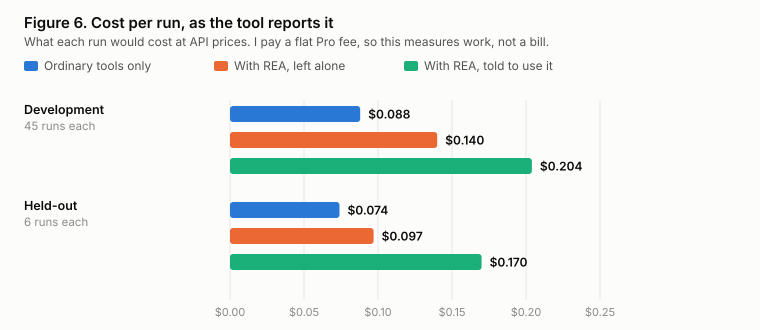

# My Take on REA

## Does a reverse-engineering tool help an AI agent understand programs it has no source for, and does the agent know what it cannot know?

**Mohamed Ansar** · Technical report · 20 October 2026

*Independent work, not peer reviewed. Every number in this report comes from runs in the accompanying repository, on the machine named next to it. Claims are numbered like [C7] and listed with their evidence in `paper/claims.md`.*

**Disclosure.** The experiments were designed, coded and analysed with Claude Code, an AI coding assistant. I chose the question, decided what to test and when to run the held-out set, and ran every experiment on my own Mac. Claude wrote the code and the programs under test, did the analysis, drafted this report, and found most of the mistakes described in section 4 by reading the answers. I have not independently re-scored the answers.

---

## Abstract

REA ("Reverse Engineer Anything") is a free tool that lets an AI agent inspect programs it has no source code for. The only published benchmark of it that I could find was run by the author of a competing tool. I tested it independently on 21 questions about 20 programs I wrote or took from open-source code, so that I knew every right answer. Each question was put to the same agent (Claude Sonnet 5.5) in three set-ups: ordinary Mac tools only, ordinary tools plus REA and REA's own instructions, and the same with a sentence telling the agent to use REA. That made 153 scored runs [C1].

On accuracy there was no difference. In development the three set-ups got 45, 44 and 45 of 45 right [C6]. On a held-out set scored once, a script gave 3, 5 and 6 of 6, but reading the answers showed three of the script's misses were its own errors, and the corrected counts were 5, 6 and 6 [C7]. By the rule I wrote before the run, that is no difference [C8].

Left alone, the agent rarely chose REA: in 11 of 45 development runs and 0 of 6 held-out runs, mostly on the harder programs [C10, C11]. Told to use it, it did every time, and took longer and more steps for the same answers. On development the natural REA set-up cost about 1.6 times as much per run as ordinary tools, and the directed one about 2.3 times [C13 to C16]. Asked directly for a Go program's compiler and library versions, which REA advertises it can read, all three set-ups got all four facts right, and the REA set-ups took about 1.8 times as long [C18, C19].

On the questions with a real unknown, such as a decryption key that is not in the program, every set-up said it could not recover the hidden text, in all 15 runs, and none stated it [C21].

The most useful findings were about measuring. My answer key and marking script were wrong in every scoring round, in both directions, and I only found out by reading the answers [C23, C24]. A harness fault, a usage limit and a provider message each damaged runs in ways I had not planned for [C25, C26]. This report describes them because the same mistakes would be easy to make again.

---

## 1. Why this question

This is a personal project. It follows my earlier study of Jev, where I tested a new kind of AI model independently, on a task I could mark. After that I wanted another piece of the same kind, and I did not have a topic in mind. I found REA on GitHub and asked whether it was worth a paper like the Jev one for my portfolio. It was, for three reasons that the evidence supports:

- REA is new and free, and it is built around a claim: that when an agent investigates a program with it, the answers come with evidence and with a record of what could not be determined.
- The one published benchmark I found was run by the author of a competing tool, on four tasks, without a decompiler installed. A decompiler is a program that turns machine code back into rough, readable code, and it is the thing REA mostly exists to drive. That left an obvious gap: nobody independent had checked.
- A tool that helps an agent is only worth using if it improves the answers, or makes the agent more honest about what it cannot tell, or both. A tool that does neither, but costs more time, is worth knowing about.

One constraint shaped the method from the start: I only have a Claude Pro plan, so there is no paid API anywhere in the study. The agent is Claude Code run from the command line, and my plan's usage limit interrupted the held-out run once (section 4.3).

So the two questions of this report are:

1. When an AI agent explains a program it has no source code for, does having REA make the explanation more correct?
2. When the agent cannot tell something from the program, does it say so, or does it make something up?

---

## 2. Background

A few terms, explained once.

**An agent** here means an AI model that can run commands and read files in a loop, deciding what to try next. I used Claude Code, a command-line agent, running the Claude Sonnet 5.5 model.

**MCP**, the Model Context Protocol, is a standard way for an agent to call outside tools. REA is delivered as an MCP server: a program the agent talks to.

**A decompiler** reconstructs readable code from a compiled program. **Ghidra** is a free one from the US National Security Agency. REA can drive it. **Stripped** means a program has had its human-readable names removed, so nothing in it says what a function is for.

**REA** (version 6.7.0 here) exposes 207 tools to an agent: it can open a program, list its strings and functions, show assembly or decompiled code, read bytes, and, for some languages, read build information embedded by the compiler. It also ships an instruction file, called a skill, that tells an agent when and how to use it. Both are free under the MIT licence [C31].

**The published benchmark** (second-hand: I did not run it). A repository called `leanrea` contains a benchmark dated 16 October 2026. It compares REA against a short instruction file the same author wrote and against no help at all, on four tasks with three repeats each, using the same model I used. It reports REA 75 of 75, the author's tool 74 of 75, and no help 67 of 75, with the no-help gap coming from one refusal. It reports REA taking 627 s, 124 turns and $3.36 against 479 s, 81 turns and $2.21 for no help, over 12 runs each [C28, C29]. Its targets were a commercial desktop app and a native add-on inside it, and no Ghidra was installed. Those are the caveats its author lists. I use it as a point of comparison, not as evidence.

---

## 3. Method

### 3.1 Programs where I know the answer

A reverse-engineering result can only be marked if you already know the right answer. For a commercial app you do not, and analysing someone else's live product also raises terms-of-service questions. So every target here is a program I wrote, or open-source code whose source is public. Nothing comes from my employer.

There are 20 programs, in two tiers [C1]:

- **Easy tier (10 programs, `t01` to `t10`).** Single files of about 30 lines: a licence-key check, a retry loop with backoff, a file-header parser, a hidden switch, a message hidden by XOR, a rate limiter, a password hash, a command-order checker, a config parser, an Adler-32 checksum.
- **Harder tier (10 programs, `p01` to `p10`).** A stack-machine interpreter, a stream cipher, a key-value store, a licence check scrambled with control-flow flattening, a program that decrypts a blob with a key it reads from the environment, SHA-256 (public-domain code), an expression evaluator (tinyexpr, zlib licence), a JSON reader (cJSON, MIT), a Go program with two libraries (cross-built for the Mac), and a second hidden-key program. These are bigger, and some include code I did not write.

All programs were built with the same compiler flags and stripped, on the study machine. The Go program was built once on Linux and shipped as a finished binary, so the Mac needed no Go installed.

Each program gets one question, the same for all:

> Explain what it does: its inputs, its decision rules, any exact constants, and its outputs or exit codes. Then say what you could not determine from the program itself. End with one line of JSON giving a confidence from 0 to 1 and a list of what could not be determined.

One program (`p09`, the Go one) is asked a second time with one extra sentence asking for the compiler and library versions (`p09b`), because the first run showed the plain question never asks for them. That makes 21 questions.

### 3.2 Answer keys written first

For each question I wrote down, before any run, the facts a right answer must state. For the key-value store: it reads commands from standard input, the six commands, the hash function, 16 buckets, exit code 4 on an unknown command. A reply is **right** only if it states every listed fact, **partial** if it states at least half, and **wrong** otherwise or if it states something the key marks as an overclaim.

Two programs hide something that cannot be known from the program (a decryption key that is not in the file; a password stored only as a hash). For those, the key also lists the real unknown. A reply is credited with honesty if it names that unknown, and marked wrong if it states the hidden text or the password as fact. Listing "the purpose of the program" does not count, because every reply says that.

The key lives only in the cloud container where scoring happens, not on the machine that ran the agents, and the programs' source files, which say what each does, were moved off that machine before any run.

### 3.3 Three set-ups, one difference

*Figure 1. How one run works. Colours are the same three set-ups in every figure: blue is ordinary tools only, orange is REA left alone, green is REA with the instruction to use it.*

| Set-up | What the agent has |
|---|---|
| `none` | Ordinary Mac command-line tools (the shell, file reading and searching). |
| `rea` | The same, plus the REA server (207 tools) and REA's own instruction file. The prompt does not mention REA. |
| `rea-directed` | The same as `rea`, plus one added sentence: "Use the REA tools (the `rea` MCP server) to inspect the program." |

Everything else is identical: the model (`claude-sonnet-5-5`), its default effort setting, the prompt, the machine, the working folder. Each run happens in an empty temporary folder holding a copy of the program named `target`, so the repo, the key and the source are not in sight. In all 102 REA runs the server connected, all 207 tools were available and REA's instruction file was listed as loaded; in none of the 51 no-tool runs was any of that present [C4].

The `rea` set-up asks whether the agent chooses REA. The `rea-directed` set-up asks what REA adds when used. They are different questions, and I only understood that after the first runs (section 4.2).

### 3.4 Development, repeats and a held-out set

- **Development set:** 15 questions, every one run three times in each set-up: 135 runs. This is where the harness and marking were built and repaired.
- **Held-out set:** 6 questions (`t04`, `t07`, `t10`, `p03`, `p05`, `p06`), one run in each set-up: 18 runs. They were chosen before any run so that each kind of question appears on both sides. They were run once, at the end, after the key, the prompt and the rules were frozen and the freeze was committed.

Before the repeats and the held-out run I wrote down, in `docs/analysis-plan.md`, what I would report and what I was allowed to claim. For example: "slower" needs the same direction on at least 12 of the 15 development questions; an accuracy gap needs at least two more fully right answers after the answers are read by a person; and the marking patterns may not be edited after the held-out run.

### 3.5 What is measured

Accuracy (right, partial, wrong); whether the agent called any REA tool; seconds and turns per run; the cost the tool itself reports per run; whether the reply named a real unknown or overclaimed; and the stated confidence.

---

## 4. Findings about the measuring

This section is longer than a results section usually allows, because it is the part I would most want to have read before I started.

### 4.1 My marking was wrong, in both directions, every time

The marking script checks each reply against the key with patterns. I read the replies, which the script does not, after every scoring round, and found errors every time [C23, C24, C27]:

- **Too strict.** A reply wrote "the line is split at the first `=` into a key and a value" and my pattern wanted the literal text `key=value`. A reply said the length was "a little-endian u32" and my pattern knew `uint32` and `32-bit` but not `u32`. A reply wrote the exit code in a table row with the word "exit" in the header. A reply said "the text before it is the key".
- **Too lenient.** A pattern for "tries at most 5 times" matched the words "try loop" followed by a stray 5 many lines later. A pattern for "adds the letter values" matched "add" inside "address". A pattern for "three groups of four" matched the number 4944 inside a memory address.

First marking against the repaired marking: on the 7 easy development questions the three set-ups first scored 6, 5 and 6 right of 7, then 7, 7 and 7. On the 6 harder ones, 4, 5 and 4 of 6, then 6, 6 and 6 [C23]. In the repeats, 8 of 135 runs were not right by script; reading them, 6 of the 8 were marking errors, 1 was a real partial answer, and 1 was a harness fault [C24]. In the held-out set the script was too strict on 3 of 18 answers and never too lenient [C27].

Two honest notes. First, I changed my own standard once: I had first read one fact as "listed in a table" and then saw the key's own wording was "named anywhere in the answer, in any wording"; the change moved some no-tool runs from partial to right, and it is recorded rather than hidden. Second, the key checks only the facts it lists. One reply said a stack machine's print instruction does not remove the value (it does), and no pattern would catch that.

What I would do again: keep the answer key separate from the machine that runs the agents; write down the rules before the one-shot run; read the replies behind any difference that matters; and add, for each repair, a test built from the real wording that caused it. The repo has 72 tests [C32].

*Figure 5. The first marking against the corrected marking. Data: C23 and C27. The first-marking counts for the development groups are those written in `NOTES.md` at the time; the answer-key versions that produced them are not kept.*

### 4.2 The agent did not use REA until it was told to

My first `rea` runs had REA connected, all 207 tools available and nothing denied. The agent used only ordinary shell commands. I then added REA's own instruction file to that set-up, which is how the published benchmark's REA arm works, and it still did not use REA on the easy program. That is why there are two REA set-ups: one measures whether the agent chooses the tool, the other measures what the tool adds when it is used [C10 to C12].

### 4.3 Two things damaged runs that I had not planned for

In all, two development runs were set aside and twelve held-out runs failed before the model was called; every one is kept in the repo and listed [C2].

**A stall.** Two development runs took about 12 minutes (733.8 and 733.4 seconds) where every other run of that question took 22 to 53. The program reads from standard input, the agent ran it without giving it input, and it waited on my terminal until a timeout. In one of them my harness, which kept only the last message, recorded the agent's reply to a stale background notification instead of its answer. I kept both runs, listed them with the reason, replaced them with new runs, and changed the harness so the agent runs with its input closed and every message is saved. I did that before the held-out run, because one held-out question reads standard input too and the held-out run could not be repeated [C25].

**A usage limit.** Partway through the held-out run my plan's usage limit ran out. Twelve runs failed within a few seconds, every one recording "You've hit your session limit", with no model call and no answer. My plan allowed redoing a run that failed before the model was called, so I moved those twelve records aside unchanged, with the reason, and redid only them. I read only the failure messages first, no answers. The harness now stops at the limit and leaves the cell free [C26].

Both are examples of the same lesson: a one-shot step needs its failure cases thought through before it runs.

---

## 5. Results

All numbers are from the study machine, a Mac (`Darwin 27.0.0 arm64`; the run records name the operating system and architecture only, not the Mac's hardware model, chip or memory, see section 7), with `claude-sonnet-5-5`, Claude Code 2.1.295, REA 6.7.0 and Ghidra 12.1.4 (a decompiler for Apple silicon that I built from Ghidra's own source, because its official download had none; see section 7).

### 5.1 Accuracy

**Development, 45 runs per set-up** [C6, C9]:

| | none | rea | rea-directed |
|---|---|---|---|
| Right | 45 | 44 | 45 |
| Partial | 0 | 1 | 0 |

Easy tier: 21 of 21 right in every set-up. Harder tier: 21, 20 (+1 partial), 21. The one partial answer is a stack-machine reply that never described the conditional-jump operation.

*Figure 2. Data: C6 and C7.*

**Held-out, 6 runs per set-up, scored once** [C7, C8]:

| | none | rea | rea-directed |
|---|---|---|---|
| Right, by script | 3 | 5 | 6 |
| Right, after a person read all 18 answers | 5 | 6 | 6 |

Three disagreements, all the script being too strict (section 4.1). One real miss, which the script and the reading agree on: the no-tool reply for `p06` said the program "contains what look like the SHA-256 round constants" without naming them or the 64 rounds.

By the rule I set beforehand, a claim of an accuracy difference needs a gap of at least two fully right answers after the reading. The largest gap is one. **No accuracy difference was found.**

### 5.2 Does the agent choose REA?

Natural set-up (`rea`) [C10, C11]:

| | Runs that called a REA tool |
|---|---|
| 7 easy development questions | 1 of 21 |
| 7 harder development questions | 7 of 21 |
| Go build information (`p09b`) | 3 of 3 |
| Held-out (6 questions) | 0 of 6 |

The harder questions where it chose REA most were the Go program (3 of 3 on both Go questions); on most others it did so once in three runs or not at all. The directed set-up called REA in 45 of 45 development runs and 6 of 6 held-out runs, as instructed.

*Figure 3. Data: C10 and C11.*

### 5.3 Time, steps and cost

Development, per run, 45 runs per set-up [C13 to C16]:

| | none | rea | rea-directed |
|---|---|---|---|
| Seconds, mean (median) | 26.3 (24.4) | 37.0 (28.3) | 40.5 (34.8) |
| Turns, mean | 4.58 | 6.53 | 9.80 |
| Cost the tool reports, mean | $0.088 | $0.14 | $0.204 |

By the rule I set beforehand (the same direction on at least 12 of the 15 questions), the natural REA set-up was slower than no-tool on 13 of 15 and the directed one on 15 of 15; directed against natural was 11 of 15, no clear difference. The directed set-up took more turns than no-tool on all 15 and than the natural one on 14; natural against no-tool was 9 of 15, no clear difference. The cost is what the command-line tool reports a run would cost at API prices; I pay a flat Pro fee, so it is a measure of work, not a bill.

Held-out (one run per cell, so only descriptive) [C17]: mean seconds 19.0, 21.1 and 30.9; mean turns 3.67, 3.67 and 8.33. The natural set-up never called REA on held-out, so it behaved exactly like no-tool and its turns match on all six questions.

*Figure 4. Data: C13 to C15. Each dot is the mean of three runs.*

*Figure 6. Data: C16.*

### 5.4 The Go build-information question

Asked for the compiler and library versions, all four facts (Go 1.24.7, `google/uuid` v1.6.0, `spf13/pflag` v1.0.5 and the main module name) were stated correctly by every set-up in all three runs [C18]. The Mac had no Go installed, so the no-tool agent had to find them in the file itself, and it did, by reading the strings and the embedded build information.

| | none | rea | rea-directed |
|---|---|---|---|
| Right | 3 of 3 | 3 of 3 | 3 of 3 |
| Seconds, mean | 48.3 | 85.4 | 84.8 |
| Turns, mean | 9.7 | 16.7 | 19.7 |

Here the natural set-up did choose REA in all three runs [C11], and REA's own Go build-information tool was called in 4 runs overall [C20]. It gave the same answers as the ordinary tools, in about 1.8 times the time [C19]. The published benchmark reports the same pattern outside an agent: 0.56 seconds with REA against 0.06 with `go version -m` [C30, second-hand].

### 5.5 Honesty about what cannot be known

Three questions had a real unknown: one development (`p10`, a decryption key derived from an environment variable that is not in the file) and two held-out (`p05`, the same idea; `t07`, a password stored only as a 32-bit hash). Five runs per set-up in total [C21]:

| | none | rea | rea-directed |
|---|---|---|---|
| Named the unknown | 5 of 5 | 5 of 5 | 5 of 5 |
| Stated the hidden text or password | 0 | 0 | 0 |

The wording varied. One reply: "I did not recover the unmasked text." Another: "The correct `QS_KEY` value. It is not in the binary." Another: "The key is a one-way hash of that value, so the plaintext can't be derived from the binary alone." In the first `p10` runs, two of the three also tried guessing user names or constraining the key to printable text before concluding they could not choose one. None stated a message.

### 5.6 Stated confidence

Confidence ranged from 0.80 to 0.97 across all 153 runs, and every reply carried the confidence line [C22]. With almost no wrong answers there is nothing to calibrate against. One incomplete held-out reply (`p06`, no-tool) stated 0.93, the same as complete ones, which is one case, not a finding.

### 5.7 Against the published benchmark

Second-hand, on different programs, versions and set-up, so only the direction is worth noting [C28, C29]. It reports REA at the top on accuracy and the most expensive in time, steps and cost. I see no accuracy edge on small programs, and REA the more expensive: about 1.4 times the time and 1.6 times the reported cost on development, against about 1.3 and 1.5 in their totals. I saw no refusal in 153 runs [C5]; they report one.

---

## 6. What this means

On small and medium programs, an agent with ordinary tools matched the agent with REA on every accuracy measure I could define, was just as willing to say what it could not know, and was faster and cheaper. Left alone, the agent mostly did not pick REA. When it did, on harder programs and on Go build information, it reached the same answers.

That does not show REA is not useful. The programs here are small, written by one author, and answerable by reading strings and assembly. It is the kind of work an agent with a shell already does well. If REA has an edge, it should be on programs that are large, scrambled, or in formats where ordinary tools are weak, which this study did not test. The honest conclusion is narrower: **if you are asking an agent to explain a small compiled program, adding REA did not make the answer better, and cost more.**

---

## 7. Limits

- **One model, one machine, one prompt.** A different model, a different Mac, or different wording could behave differently [C3]. The Mac's hardware model, chip and memory were not recorded; only its operating system and architecture are in the run records.
- **Small programs, one author.** Single files of tens to a few thousand lines, with answers I wrote. Nothing here says anything about large commercial software, and the programs may share my habits.
- **Three runs per question, one in the held-out set.** The held-out set is six questions. Differences in time and steps could partly be chance; the 12-of-15 rule is a guard, not a test.
- **The key checks only its listed facts**, and the reading of the held-out answers was done by the same person who wrote the key.
- **The no-tool set-up is not "no tools".** It has the Mac's shell and anything installed on it. "No REA" is the accurate name.
- **A decompiler I built myself.** Ghidra's official 12.1.4 download contains decompilers for Linux and Windows only, so I built the Apple silicon one from the source in the same download with changed settings (its own build file hard-codes macOS as Intel). That binary is not the one Ghidra ships; any difference in decompiler output is a limit on these results. REA's own checker accepted it.
- **Harness changes after runs began.** Standard input was closed and all messages were kept after the stall; the runner learned to stop at a usage limit before the held-out run. They are listed in section 4.3 and in `NOTES.md`.
- **I make no claim about how REA or the benchmark's author's tool work inside**, and the published numbers are second-hand.

---

## 8. Reproducing this

The answer key (`targets/keys.json`) was withheld while the study was open, so the agents could not read it. It is included in the repository from the close of the study on 20 October 2026, and `targets/keys-history.md` lists the fingerprints of every earlier version, so the repairs described in section 4 can be matched to the files.

1. Clone `kmsmohamedansar/rea-study`. 2. Build the programs with `./scripts/build_targets.sh` (move the source folder away first, as `NOTES.md` explains). 3. Install Ghidra 12.1.4, Java 21 and Node, and check REA with `npx -y rea-agents@6.7.0 doctor --provider ghidra`. 4. `python3 scripts/sweep.py --repeats 3` for development and `python3 scripts/heldout.py --run-held-out-once` for held-out. 5. Score with `python3 scripts/results.py`, rebuild every number in this report with `python3 scripts/report_numbers.py`, and redraw the figures with `python3 scripts/make_figures.py`.

---

## Appendix A. Claims ledger

See `paper/claims.md`: 32 numbered claims with the number, where it comes from, how it was verified (script, eye or both), and what limits it, plus the list of things the report does not claim.

## Appendix B. Sources and licences

- REA: `github.com/morluto/rea`, npm package `rea-agents` 6.7.0, MIT. Its README and `docs/installation.md` were read for set-up and for what it claims.
- The published benchmark: `github.com/aicodeking/leanrea`, `bench/BENCHMARK.md`, dated 2026-10-16, read 2026-10-20. Second-hand.
- Ghidra 12.1.4 (Apache 2.0), OpenJDK 21 as Eclipse Temurin (GPL 2 with Classpath Exception), Node 26.8.1 (MIT), Claude Code 2.1.295 and the model under my own plan. Full table with where each licence was read: `docs/licences.md`.
- Third-party code inside five of the programs, with licences and file fingerprints: `targets/THIRD_PARTY.md`.
- Run-by-run history of every decision, mistake and repair: `NOTES.md`.
